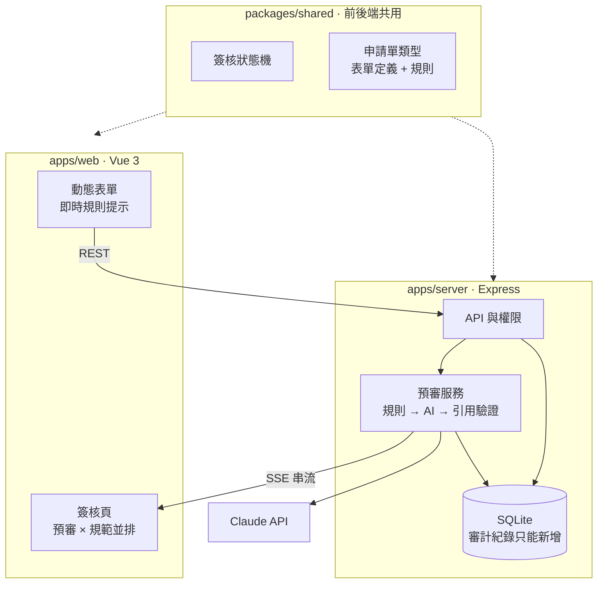

# AI 預審簽核系統

[](https://github.com/livoist/ai-approval/actions/workflows/ci.yml)

員工送出申請單時，系統依公司規範自動預審：**明確的規則交給程式判斷，模糊的判斷交給 AI**，每一條意見都附上規範條文依據。主管看著預審結果與原文並排簽核，AI 不做決定，全程可追溯。

<!-- TODO：放上 30 秒 demo 影片或 GIF -->
<!-- TODO：線上試用網址與測試帳號 -->

## 解決什麼問題

大型企業與金融業的內部簽核有三個共同的痛點：

- **規範多、記不住**：設備維修 SOP、費用報銷辦法動輒數十條，申請人常漏填、主管也不一定每條都記得
- **簽核量大**：主管每天看大量類似的單，很難每張都仔細對照規範
- **出事要能追責**：誰在什麼時候、依據哪一條規定核准的，事後一定要查得到

這個系統在主管看到申請單之前，先把「有沒有違反規範」整理好，並且把依據攤在旁邊，讓主管更快、更有根據地做決定。

## 功能

- **兩種申請單**：設備維修、費用報銷；新增第三種只需要寫一份定義，不用改流程程式碼
- **邊填邊提示**：填單時即時顯示「這樣送出會被標記什麼」，可以先補齊再送
- **AI 串流預審**：送出後，預審意見一條一條即時出現在畫面上
- **引用追溯**：每條意見附條文 id，點一下右側規範原文自動捲動並高亮
- **主管評價 AI**：主管可以標記 AI 的某條意見「有誤」並寫下理由，作為之後改進 AI 的依據
- **AI 準確度儀表板**：把主管的評價累積成認同率、每日趨勢、最常出錯的條文與主管寫的理由，換模型或改 prompt 後可以比較前後差異
- **完整簽核流程**：核准、退回、要求補件、補件後修改重送、撤回
- **規範決定簽核路線**：維修超過 50 萬、報銷超過 3 萬時，主管核准後自動多一關廠長；簽核頁畫出這張單實際會走的路線
- **不可竄改的紀錄**：每個動作都留下審計紀錄，資料庫層直接禁止修改與刪除

## 預審怎麼分工

| 負責 | 檢查什麼 | 例子 | 結果 |
| --- | --- | --- | --- |
| 表單驗證 | 資料格式 | 設備編號格式錯誤、金額不是數字 | 擋下，不能送出 |
| 規則引擎 | 明確的規範 | 480V 以上未附斷電紀錄、招待費每人超過 2,000 元、超過 60 天才報銷 | 可以送出，標記為「規則」 |
| AI | 需要判讀的部分 | 故障說明是否具體、報銷事由與業務的關聯 | 可以送出，標記為「AI」 |

數字門檻、必附文件這類判斷，程式永遠不會看錯，AI 卻有可能。所以**能寫成 if 的規範一律不交給 AI**，AI 只負責規則做不到的事，而且會先知道規則已經查到什麼，避免重複。

## 架構



前端只跟自己的後端溝通，API key 與模型呼叫都在後端；前後端共用的規則放在 `packages/shared`，兩邊永遠一致。

| 層 | 技術 |
| --- | --- |
| 前端 | Vue 3、TypeScript、Vite、Tailwind CSS v4、ECharts |
| 後端 | Express 5、TypeScript、better-sqlite3 |
| AI | Claude API（Structured Outputs + 串流） |
| 測試 | Vitest、Supertest、Playwright |
| 專案結構 | pnpm workspace（monorepo） |
| CI | GitHub Actions |

```
ai-approval/
├── apps/
│   ├── web/          # Vue 3 前端
│   └── server/       # Express 後端、預審服務、SQLite
├── packages/
│   └── shared/       # 狀態機、表單定義、規則引擎、SSE 解析（前後端共用）
└── e2e/              # Playwright 端對端測試
```

## 本機啟動

需要 Node.js 20 以上與 pnpm。

```bash
pnpm install
```

開兩個終端機，分別啟動後端與前端：

```bash
pnpm dev:server          # http://localhost:3001
pnpm dev:web             # http://localhost:5173
```

打開 http://localhost:5173 ，右上角可以切換身分（申請人 Alice、Bob，主管王經理，廠長林廠長）。新增申請時可以點「範例資料」一鍵帶入不同情境。

### 使用真的 Claude

沒有設定 API key 時，系統會使用固定結果的模擬審查員，所有功能一樣可以使用。要改用 Claude：

```bash
cp apps/server/.env.example apps/server/.env
# 在 .env 填入 ANTHROPIC_API_KEY
```

### 清空資料

```bash
pnpm --filter @ai-approval/server db:reset
```

## 測試

```bash
pnpm typecheck           # 所有套件的型別檢查
pnpm test                # 單元測試與 API 測試
pnpm e2e                 # 端對端測試：會自動啟動一組獨立的前後端（port 3101、5273）
```

E2E 用真的瀏覽器跑完整流程：填單驗證、AI 預審、點引用高亮、主管評價、要求補件、修改重送、核准、權限、清單篩選、第二種申請單、兩層簽核，以及 AI 準確度儀表板。CI 在每次 push 時跑以上全部。

## 部署

部署在 [Render](https://render.com)，設定都寫在 [`render.yaml`](render.yaml)：

- **前後端是同一個服務**：Express 的 API 掛在 `/api`，同時提供打包好的 Vue 頁面。只有一個網址，沒有跨網域問題，SSE 串流也不會被 serverless 平台切斷
- **示範資料**：`DEMO=true` 時，啟動後自動放入各種狀態的申請單；資料只存在記憶體，服務休眠後喚醒就是一組全新的資料
- **AI 使用上限**：`AI_DAILY_LIMIT` 控制每天最多呼叫 Claude 幾次，用完、或 Claude 出錯時，自動改用模擬審查員，demo 不會壞掉

在 Render 選 **New → Blueprint** 連上這個 repo，再到服務的 Environment 頁面填入 `ANTHROPIC_API_KEY` 即可。

## 設計決策

### 簽核狀態用轉換表管理，前後端共用

所有合法的狀態變化集中寫在 [`request-machine.ts`](packages/shared/src/request-machine.ts) 的 `TRANSITIONS`，不在表上的一律拒絕。前端用 `availableEvents()` 決定顯示哪些按鈕，後端用 `transition()` 驗證請求，兩邊讀同一張表，不會出現「畫面上有按鈕、後端卻拒絕」。

主管核准之後要直接結案還是再送廠長，取決於申請單的內容，所以轉換規則可以帶**守衛條件**（guard）：同一個「狀態 + 事件」有兩條規則，依條件選出一條。條件由規則引擎算出：規則上標記 `escalatesToPlantManager`，成立時就多一關。前端畫簽核路線、後端決定下一步，用的是同一個 `needsPlantManager()`。

失敗回傳 `{ ok: false, reason }` 而不是丟例外，TypeScript 會強迫呼叫端處理失敗，`invalid_transition` 與 `forbidden` 分別對應到 HTTP 409 與 403。

### 申請單類型是資料，不是頁面

一種申請單 = 表單定義 + 規則 + 對應的規範文件（[`forms/`](packages/shared/src/forms)）。前端的 `DynamicForm` 照著定義畫出表單，後端用同一份定義驗證，狀態機、預審、串流、評價完全不知道現在處理的是哪一種單。新增費用報銷時，流程程式碼一行都沒有改。

### AI 的輸出不能直接相信

- 用 Structured Outputs 要求固定的 JSON 格式，不用自己解析散文
- AI 只能回傳條文 id；後端驗證 id 真的存在於**這種申請單的**規範文件中，不存在的直接剔除，畫面上的每個引用一定點得開
- 規範中找不到依據的疑慮，prompt 要求不要列出：寧可不說，也不能亂講

### 串流：從收到一半的 JSON 裡取出完整的意見

模型一個字一個字輸出 JSON，收到一半時 `JSON.parse` 一定失敗。[`partial-json.ts`](apps/server/src/partial-json.ts) 逐字掃描，用大括號深度判斷一條意見何時完整，就先推給前端。schema 把 `findings` 放在最前面，讓意見比摘要先出來。

前端沒有用瀏覽器內建的 `EventSource`，因為它不能自訂 header，而身分驗證放在 header 裡；改用 `fetch` 讀串流、自己解析 SSE，還能用 `AbortController` 隨時中斷。串流只負責體驗，預審結束後一律以後端存下的結果為準。

### AI 看到的是哪個版本

AI 在背景審查的這幾秒，申請單可能已經被補件成新版本。預審結果會記下它審的是第幾版，版本對不上就作廢，不會拿舊版本的結果推進新版本的狀態。伺服器重啟時，也會找出預審到一半被中斷的單重新處理，不讓它永遠卡在「預審中」。

### 審計紀錄在資料庫層不可竄改

審計紀錄與主管評價只能新增；SQLite 的 `TRIGGER` 直接拒絕 `UPDATE` 與 `DELETE`。就算程式碼寫錯、或有人直接連進資料庫下指令，也改不了歷史。「目前的評價」是從歷史推算出來的最新一筆，改主意就再新增一筆。

### 資料層用介面隔開，用合約測試確保行為一致

service 只依賴 `Store` 介面。記憶體版與 SQLite 版跑同一組[合約測試](apps/server/src/store.contract.test.ts)，兩邊都通過就代表可以互換。從記憶體換成 SQLite 時，service 與 API 一行都沒改。資料表結構的變更用 `PRAGMA user_version` 記錄的遷移步驟處理，舊資料不會遺失。

### AI 準不準，由簽核的人說了算

AI 的意見沒有標準答案，唯一可靠的判斷來自每天在簽核的主管。所以評價就做在簽核頁上，順手按一下就好，[`ai-stats.ts`](apps/server/src/ai-stats.ts) 再把它們累積成數字：

- **認同率只算有評價的意見**：沒評價不代表正確，混進來會讓數字虛高；覆蓋率另外顯示
- **依引用條文排行**：哪一條規範最常被主管否定，就是下一步要調整 prompt 的地方，旁邊附上主管寫的理由
- **依審查員分組**：換模型或改 prompt 之後，可以直接比較前後的認同率
- **規則的意見不列入**：那是程式判斷的，沒有對錯可言

### 外部依賴一律從外面傳進來

AI 審查員是一個介面：有 API key 用 Claude，沒有就用模擬審查員，測試不花錢、結果固定，demo 時斷網也有備援。規則需要的「今天」、service 用的時鐘也從外面傳入：「超過 60 天」這類規則才測得了，示範資料也能放在過去兩週，讓儀表板一打開就有趨勢可看。

## 新增一種申請單

1. 在 `packages/shared/src/forms/` 新增一個檔案，寫表單定義與規則
2. 在 `forms/index.ts` 的 `FORM_KINDS` 註冊
3. 在 `apps/server/src/policies.ts` 加入它依據的規範條文
4. 在 `apps/server/src/reviewer.ts` 的模擬審查員補上這種單的設定

測試會自動檢查每條規則引用的條文都存在、而且屬於這種申請單的規範文件。

## 已知限制與下一步

- 登入是示範用的假帳號，正式使用需要接公司的 SSO 與組織架構
- 規則寫在程式碼裡，還不能由管理者在畫面上調整
- 規範文件是手寫的條文，還不支援匯入 PDF
- 儀表板只告訴你 AI 哪裡錯，還不會自動把主管的理由回饋進 prompt

---

規範文件與範例資料均為自行撰寫的模擬內容，不代表任何真實公司的規定。
